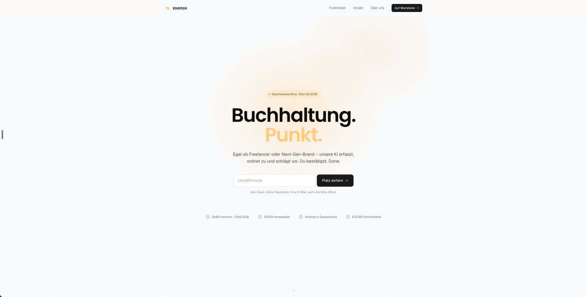
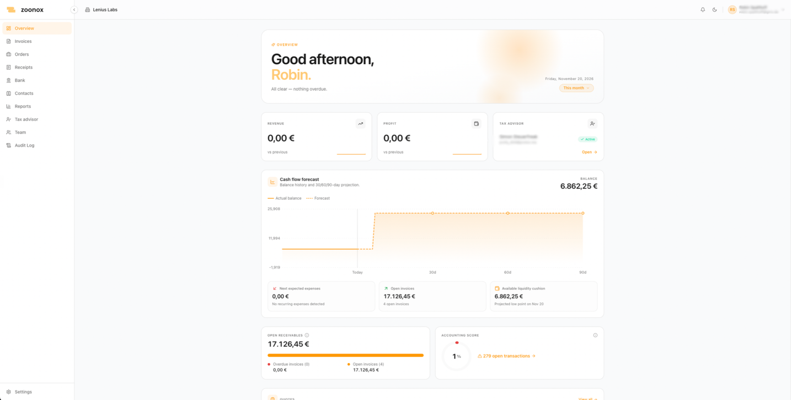
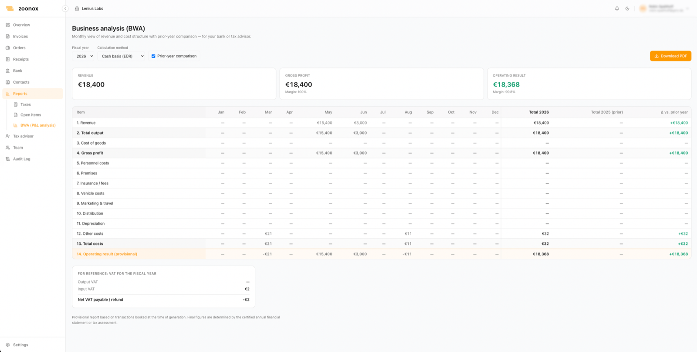

# zoonox

> **Archived — November 2026.** The hosted service has been shut down. The code
> is published as-is, for reference. See [Why I stopped](#why-i-stopped).

German SMB accounting and e-invoicing. A side project, built solo over four
months — roughly 72,000 lines of TypeScript, 37 data models, 120 passing
unit tests.



---

## What it does

German bookkeeping is unusually format-heavy: every artifact (invoice, ledger
entry, VAT return, tax-advisor export) has a legally defined shape. zoonox
implements those shapes rather than wrapping someone else's API.

**E-invoicing**
XRechnung and ZUGFeRD XML generation, PDF/A-3 embedding, EPC payment QR codes,
and pre-send validation against the official [KoSIT validator](https://github.com/itplr-kosit/validator)
running as a Docker sidecar — an invoice that fails EN 16931 Schematron rules
cannot be sent.

**Double-entry ledger**
A posting-rules engine (SKR03 / SKR04) that writes balanced journal entries from
invoices, receipts, bank transactions and cash-book entries. Switchable between
true double-entry (Doppik) and single-entry cash accounting.

**VAT returns**
Computes the German advance VAT return (UStVA) down to the official form
USt 1 A, including reverse charge (§ 13b UStG), intra-community acquisitions,
and One-Stop-Shop. Every form field drills down to the receipts behind it.

**Reports**
Cash-basis (EÜR) and accrual (GuV) profit determination, monthly BWA with
prior-year comparison, open-items list, 90-day cash-flow forecast.

**DATEV export**
EXTF format 21 v12 posting batches plus account labels, original receipt files
and a receipt index, as a single ZIP — the handover format every German tax
advisor expects.

**Receipts & OCR**
Document capture via upload, email inbox, or a phone-camera scanner. OCR
extracts supplier, amount, date, VAT rate and line items; a semantic fingerprint
(`supplier|amount|date`) catches duplicates whose bytes differ. Reverse-charge
cases are detected from the document text.

**Banking**
PSD2 account access via Enable Banking (read-only), plus CSV, MT940 and
CAMT.053 import with automatic transaction-to-document matching.

**Tax-advisor access**
A dedicated role with its own permission set, client switching across tenants,
a month-close workflow (submit → review → finalize / reopen) and threaded
comments on individual documents.

Also: fixed-asset register with automatic depreciation runs, recurring
invoices, quotes and order confirmations, multi-currency with ECB rates,
number ranges, audit log, TOTP two-factor auth, German and English UI.

| | |
|---|---|
|  |  |
| Dashboard with cash-flow forecast | Monthly BWA with prior-year comparison |

---

## Architecture

| Layer | Choice |
|---|---|
| Framework | Next.js 16 (App Router), React 19, TypeScript |
| Data | PostgreSQL + Prisma |
| Auth | NextAuth v5, credentials + TOTP |
| Background jobs | pg-boss on Postgres — no Redis, no external scheduler |
| Storage | Local filesystem or S3-compatible (Cloudflare R2 with Object Lock) |
| PDF | @react-pdf/renderer, pdf-lib, mupdf |
| Validation | KoSIT validator (Docker sidecar) |
| Deployment | Docker, Traefik, Coolify on Hetzner |

A few decisions worth calling out:

- **The ledger is the source of truth.** Reports and the DATEV export read
  `JournalEntry` / `JournalLine`, never invoice or document totals. Orphan
  guards skip journal lines whose source row has been removed.
- **Retention over deletion.** Booked documents are GoBD-retention-bound
  (§ 147 AO, 10 years). "Deleting" one reverses its journal entries and sets
  `deletedAt`; the row and the Object-Lock-protected file stay. Only unbooked
  documents are hard-deleted.
- **pg-boss over a separate queue.** Six scheduled jobs (recurring invoices,
  depreciation, quote expiry, bank sync, cleanup, backup) run on the database
  that is already there. `SKIP LOCKED` lets replicas share the work.
- **Formats live in code, not in a vendor.** The XRechnung/ZUGFeRD writers,
  the DATEV CSV builders and the UStVA mapping are all in this repository and
  unit-tested.

```
apps/dashboard/src/
├── app/[locale]/dashboard/   routes (invoices, documents, bank, taxes, reports…)
├── lib/
│   ├── e-invoice/            XRechnung + ZUGFeRD writers, KoSIT client
│   ├── journal/              posting rules, account mapping, ledger writes
│   ├── taxes/ustva/          VAT return: form model, mapping, computation
│   ├── datev/                EXTF posting batch, master data, receipt ZIP
│   ├── reports/              EÜR / GuV, BWA
│   ├── ocr/                  Mistral OCR + OpenRouter vision fallback
│   ├── enable-banking/       PSD2 client, JWT signing, sync
│   └── fixed-assets/         depreciation plans and runs
└── ...
```

---

## Running it locally

See [docs/local-setup.md](docs/local-setup.md). Short version: Docker for
Postgres, `npm run db:migrate && npm run db:seed`, `npm run dev`. Everything
external is optional — document storage falls back to the local filesystem,
OCR falls back to a free vision model, and email simply stays unsent.

---

## What never got finished

Published honestly, because the gaps are as instructive as the features:

- **No billing.** `Tenant.plan` is a string with a default of `"free"`. Nothing
  in the app can take money.
- **No e-invoice *receiving*.** It generates XRechnung and ZUGFeRD but cannot
  parse them. Germany's receiving obligation started in January 2025; this was
  the biggest missing piece.
- **Fixed chart of accounts.** 96 (SKR03) / 89 (SKR04) accounts in a static
  JSON file. No user-defined accounts, which caps it at very small businesses.
- **No ELSTER submission.** VAT figures are computed and presented as the
  official form; transmitting them to the tax office is still manual.
- **Tenant isolation relies on discipline.** `getTenantDb()` — a Prisma
  extension that injects `tenantId` into every query — was written and then
  never adopted; 116 files use the raw client with manual `where` clauses
  instead. With real customers this should have been Postgres row-level
  security on day one. It is the thing I would fix first.
- **No recurring expense documents** (only recurring outbound invoices), no
  annual financial statement, no E2E tests, no error tracking.

---

## Why I stopped

I validated the product before I validated the market.

By the time it was roughly 80% done, [Pennylane had raised €175M](https://www.eu-startups.com/2026/01/sequoia-backed-french-accounting-unicorn-pennylane-secures-e175-million-as-it-approaches-profitability/)
for the same thesis and launched in Germany, where Lexware Office and sevDesk
already cover the entry segment at €8–26/month and DATEV owns the tax
advisors. A solo founder does not win a saturated, regulation-heavy market
against that — not by shipping more features.

The right move would have been twenty customer conversations in month one
instead of month six. The code is open; the lesson was worth more than the
product.

---

## License

MIT — see [LICENSE](LICENSE).

This is reference code, not a maintained product. It is not tax advice, and it
carries no warranty of fitness for German bookkeeping obligations. If you run
it, you are responsible for what it computes.
